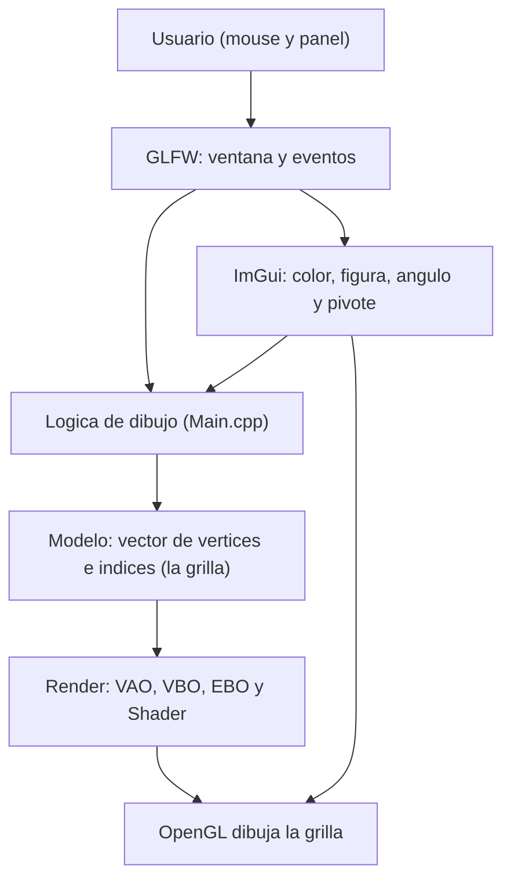

# Lienzo en cuadros

**Autor:** Abella González Carlos Enrique
**Curso:** Introducción a la Computación Gráfica

Programa de dibujo (tipo "paint") hecho en **C++ con OpenGL 3.3**. El lienzo es una grilla de 100 × 100 celdas sobre la que se dibujan líneas, círculos, polígonos y trazos libres con el **algoritmo de Bresenham**, se rotan figuras con **matrices de transformación 3×3** y se rellenan con el método de **semilla (flood fill)**. Toda la interacción se hace con una interfaz de **Dear ImGui**.

---

## Descripción general

- El lienzo se guarda como una malla de cuadrados (cada celda = 2 triángulos) y **pintar una celda es solo cambiar el color de sus 4 vértices**.
- Las figuras no se dibujan "a mano" píxel por píxel: se definen por sus **vértices** y se unen con líneas de Bresenham.
- La rotación se calcula con matrices en **coordenadas homogéneas** alrededor de un pivote elegido por el usuario.
- El panel de ImGui controla el color, la figura, el ángulo de giro y el punto de giro.

## Características

| Herramienta | Qué hace |
|---|---|
| Línea | Bresenham entre dos puntos (arrastrar el mouse) |
| Círculo | Bresenham de círculo: centro y punto del borde |
| Lápiz libre | Trazo a mano alzada, uniendo los puntos con Bresenham |
| Triángulo | Base = ancho del arrastre, altura = alto del arrastre |
| Cuadrado | Lado = mayor distancia del arrastre |
| Polígono regular | De 3 a 12 lados (vértices cada 360°/lados) |
| Polígono por clics | Un clic por vértice; clic derecho o botón para cerrar |
| Relleno (semilla) | Clic dentro de una figura cerrada |
| Rotación | Ángulo de -180° a 180° con pivote: centro de la figura, origen (0,0) o centro del lienzo |

**Figura pendiente:** al soltar el mouse la figura puede girarse o cambiar de color antes de guardarse con **Aplicar figura**. También existen **Cancelar figura** y **Limpiar lienzo**.

---

## Estructura del repositorio

```
Lienzo-en-cuadros/
├── README.md
├── Main.cpp              <- lógica del programa (figuras, matrices, relleno, bucle principal)
├── shaderClass.h / .cpp  <- clase Shader
├── VAO.h / .cpp          <- clase VAO
├── VBO.h / .cpp          <- clase VBO
├── EBO.h / .cpp          <- clase EBO
├── default.vert          <- vertex shader
├── default.frag          <- fragment shader
├── glad.c                <- cargador de OpenGL (GLAD)
├── imgui*.cpp / .h       <- Dear ImGui (interfaz)
├── imgui_impl_glfw.*     <- ImGui + GLFW
├── imgui_impl_opengl3.*  <- ImGui + OpenGL 3
└── Lienzo_en_cuadros.slnx / .vcxproj   <- proyecto de Visual Studio
```

## Código

| Archivo | Responsabilidad |
|---|---|
| [`Main.cpp`](Main.cpp) | Algoritmos de dibujo, matrices, relleno, interfaz y bucle principal |
| [`shaderClass.cpp`](shaderClass.cpp) | Lee `default.vert` y `default.frag`, los compila y los enlaza en un programa |
| [`VAO.cpp`](VAO.cpp) | Describe cómo leer los vértices (posición y color) |
| [`VBO.cpp`](VBO.cpp) | Buffer de vértices en la GPU |
| [`EBO.cpp`](EBO.cpp) | Buffer de índices (los 2 triángulos de cada celda) |
| [`default.vert`](default.vert) | Recibe posición y color de cada vértice |
| [`default.frag`](default.frag) | Pinta cada píxel con el color recibido |

### Funciones principales de `Main.cpp`

| Función | Para qué sirve |
|---|---|
| `bresenham` | Celdas de una línea entre dos puntos |
| `bresenhamCirculo` | Celdas del borde de un círculo (simetría de 8 octantes) |
| `pintarCelda` | Cambia el color de una celda (con control de límites) |
| `formaDesdeArrastre` | Calcula los vértices de cada figura a partir del arrastre del mouse |
| `Mat3`, `multiplicar`, `matTraslacion`, `matRotacion`, `aplicarMatriz` | Matrices 3×3 en coordenadas homogéneas |
| `matRotacionAlrededor` | Giro alrededor de un pivote: `T(pivote) · R(ángulo) · T(-pivote)` |
| `centroForma` | Centro de la caja que contiene la figura |
| `celdasDeForma` | Convierte una figura en la lista de celdas a pintar (usa Bresenham) |
| `dibujarForma` | Aplica la rotación y pinta la figura en el lienzo |
| `rellenoSemilla` | Relleno por semilla con 4 vecinos y pila |
| `celdaBajoCursor` | Convierte la posición del mouse (píxeles) en columna y fila |
| `main` | Inicialización, bucle principal y liberación de recursos |

---

## Arquitectura

### Vista general



### Capas

1. **Ventana y entrada (GLFW + GLAD):** crea la ventana, lee el mouse y carga las funciones de OpenGL.
2. **Interfaz (Dear ImGui):** panel con el selector de color, la lista de figuras, el ángulo, el pivote y los botones.
3. **Lógica de dibujo (`Main.cpp`):** construye los vértices de cada figura, los rota con matrices y los convierte en celdas con Bresenham. También hace el relleno.
4. **Modelo de datos:** el lienzo es un `vector<GLfloat>` con 4 vértices por celda y 6 números por vértice (X, Y, Z, R, G, B), más un `vector<GLuint>` de índices.
5. **Render (clases `VAO`, `VBO`, `EBO`, `Shader`):** sube los datos a la GPU y los dibuja con `glDrawElements`.

### Flujo de un frame

1. `glfwPollEvents` lee los eventos y ImGui prepara el frame.
2. Se calcula la celda bajo el cursor (`celdaBajoCursor`) y se arma el panel.
3. La lógica del mouse (arrastre, clics, figura pendiente) decide qué figura se está dibujando.
4. Se copia el lienzo guardado a `vista` y se dibuja encima la figura en curso (vista previa).
5. `glBufferSubData` sube `vista` a la GPU y `glDrawElements` dibuja la grilla.
6. ImGui se dibuja encima y `glfwSwapBuffers` muestra el resultado.

### Decisiones de diseño

- **Figuras como lista de vértices** (`Forma`: tipo + puntos): línea, círculo, trazo libre y polígonos se tratan igual.
- **Se giran los vértices, no los píxeles:** girar píxeles ya pintados deja huecos.
- **Dos copias del lienzo** (`vertices` y `vista`): la vista previa se mueve sin ensuciar el lienzo guardado.
- **Relleno con 4 vecinos:** las líneas de Bresenham se tocan en diagonal y con 8 vecinos el color se escaparía por las esquinas.

---

## Requisitos y cómo ejecutar

- Windows y Visual Studio (el proyecto usa C++20).
- Librerías: **GLFW** (`glfw3.lib`, `opengl32.lib`), **GLAD** (incluido: `glad.c`) y **Dear ImGui** (incluido).
- Abrir `Lienzo_en_cuadros.slnx` en Visual Studio, configurar las rutas de GLFW y de los encabezados de GLAD si hace falta y ejecutar con **F5**.
- Los archivos `default.vert` y `default.frag` deben estar en la carpeta desde donde se ejecuta el programa.

## Tecnologías

C++20 · OpenGL 3.3 (Core) · GLFW · GLAD · Dear ImGui
